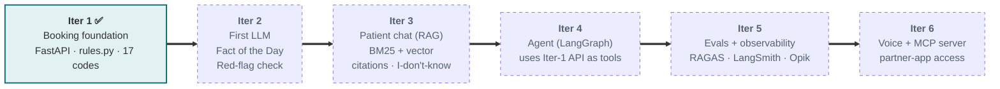
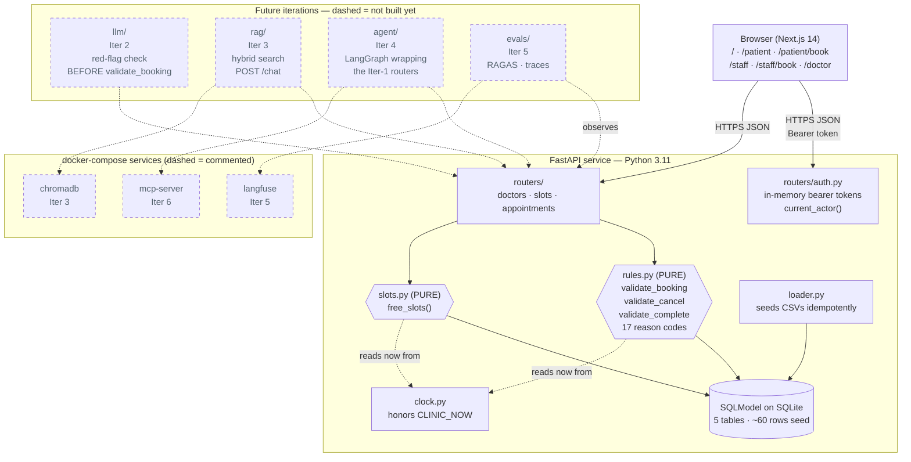
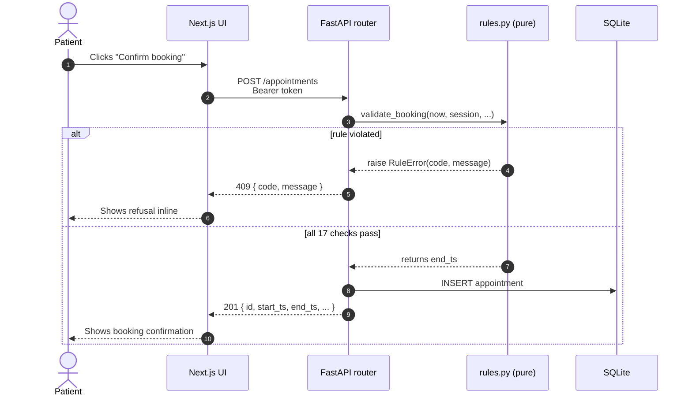
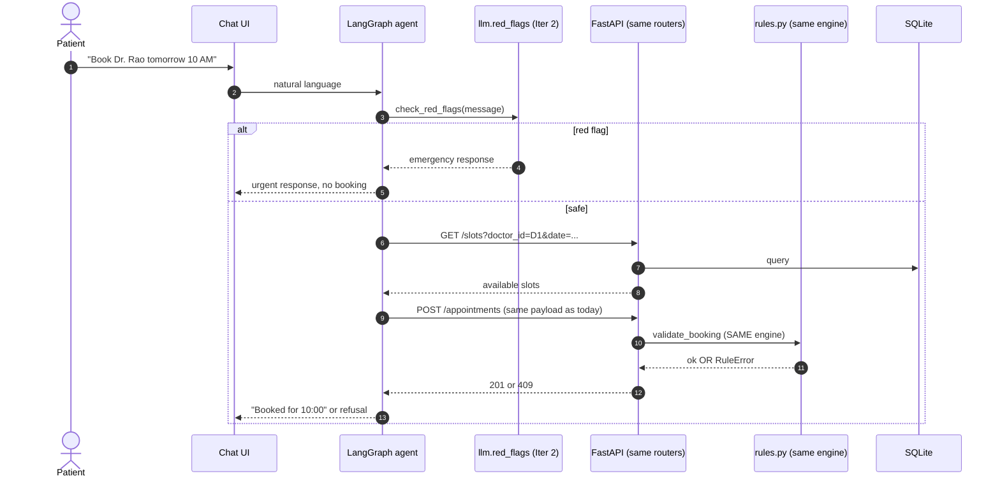
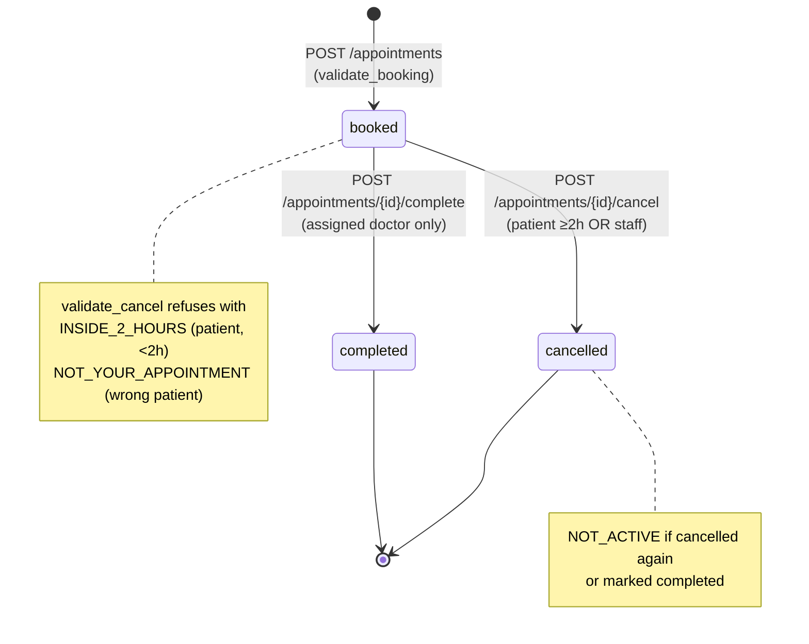
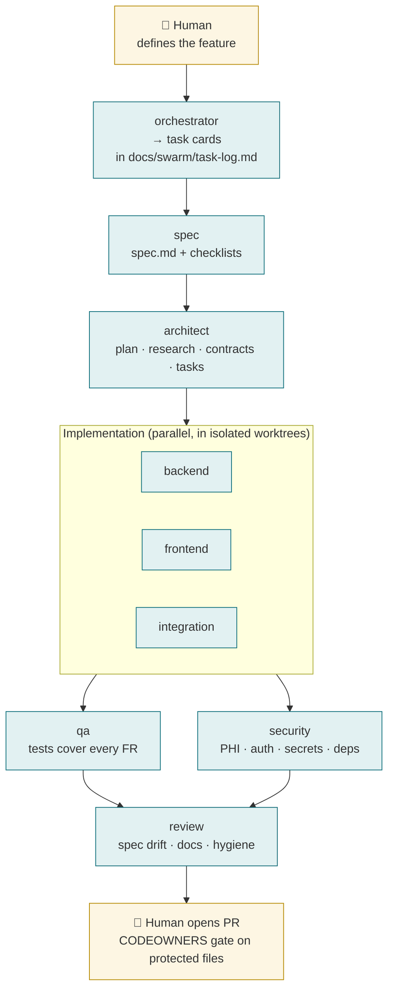

# NetraCare — AI front desk for an eye clinic

> **Fictional clinic. Synthetic data only.** NetraCare is a six-iteration
> Agentic-AI capstone building an AI-powered front desk: patients ask
> questions, the system routes them to the right specialist, manages
> appointments, and keeps staff in control — while never giving medical
> advice.

- **Status (this branch):** Iteration 1 — the booking foundation, with no
  AI inside the app yet. Every clinic rule is enforced in the backend.
- **Current tag:** —
- **Next:** Iteration 2 adds the first LLM features (Fact of the Day,
  red-flag check, doctor summaries).

---

## 1. The six-iteration map

Each iteration branches off `main` after the previous one is merged and
tagged. Each ships behind the same constitution (safety, data boundaries,
spec-driven workflow, Docker-first dev loop) and reuses the same backend
rules engine.

| # | Iteration | What it adds | Status |
|---|---|---|---|
| 1 | **Booking foundation** | FastAPI + SQLite + Next.js. Three roles, 17-code rules engine, slot computation. **No AI.** | ✅ Built on this branch |
| 2 | First LLM features | Fact of the Day, **red-flag check** on every booking, doctor summaries. LangChain basics. | 🔜 Planned |
| 3 | Patient chat (RAG) | Clinic knowledge base with hybrid search (BM25 + vector), citations, "I don't know", speciality routing. | 🔜 Planned |
| 4 | Agent | LangGraph agent that books, cancels, reschedules using the Iter-1 API as tools. Doctor-leave handling. | 🔜 Planned |
| 5 | Evals + observability | RAGAS, offline + online evals, LangSmith / Opik traces. | 🔜 Planned |
| 6 | Voice + MCP | Multimodal / voice front door. MCP server re-exports the booking APIs for partner agents. | 🔜 Planned |



Project brief: see the four HTML handouts in the user's course folder
(`NetraCare-Capstone-Brief.html` plus `Iteration-{1,2,3}.html`). The
feature spec for the current iteration lives at
`specs/001-clinic-booking-foundation/spec.md`.

---

## 2. Architecture (the whole system, dashed where not built yet)



**The invariant that stays the same across all 6 iterations:** `rules.py`
is the sole authority on whether a booking happens. The LLM may flag a
reason as a red flag (Iter 2+); the agent may call the API (Iter 4); none
of them bypass the rules engine.

---

## 3. The safety model

Taken verbatim from the project brief §07 (non-negotiables). Each item
maps to the iteration that first enforces it. Once enforced, it stays
enforced for the rest of the project.

| # | Non-negotiable | Enforced by | Enforces from |
|---|---|---|---|
| 1 | Never name a likely condition or suggest treatment | Prompt discipline + output filter | Iter 2 |
| 2 | Red-flag symptoms get the emergency response before any booking | `llm/red_flags.py` → emergency response → then rules engine | Iter 2 |
| 3 | Every policy answer cites a clinic document, or says "I don't know" | RAG `answer` chain with chunk-id gating | Iter 3 |
| 4 | Patients only ever see their own appointments and details | `auth.current_actor` + server-side scoping on every endpoint | **Iter 1 (here)** |
| 5 | Synthetic data only, never real patient data | Data pack + `.env` key hygiene + `.gitignore` | **Iter 1 (here)** |

The full binding form is in `.specify/memory/constitution.md` (v1.0.0).
Changes to that file require `/speckit-constitution` and a version bump.

---

## 4. Booking data flow — today vs. Iteration 4

**Today (Iter 1):** Patient clicks "Confirm booking" in the browser →
Next.js posts `/appointments` → FastAPI → `rules.validate_booking()` →
409 with one of the 17 reason codes, **or** insert row + 201.



**Iteration 4 (planned):** Patient types "book me with Dr. Rao tomorrow
10 AM" into chat → LangGraph agent interprets → agent calls the same
`POST /appointments` → **same rules engine** rejects or accepts. The
agent itself has no business-rule logic.



**The point:** the agent is just another HTTP client. It calls the same
endpoints the browser calls. Zero rule logic in the agent.

This is why the rules engine is pure and takes `now` as a parameter: the
agent might ask it to validate a hypothetical slot without ever inserting
a row.

### Appointment lifecycle



Follow-up unlocks after `completed`: a patient can book a `follow_up`
visit for the same `(doctor, speciality)` as their last completed one,
but **not with a different doctor** (`FOLLOW_UP_DIFFERENT_DOCTOR`).

---

## 5. The rules engine — the 17 codes

Every refusal returns one of these codes with a human-readable message.
They are the public contract across all 6 iterations (constitution
Principle I; renaming requires a major version bump).

| Code | Meaning |
|---|---|
| `INVALID_START_TIME` | Start time not on a 10-minute mark |
| `IN_PAST` | Before the clinic clock |
| `BEYOND_30_DAYS` | More than 30 days ahead |
| `CLINIC_CLOSED` | Sunday |
| `HOLIDAY` | Listed in `holidays.csv` |
| `OUTSIDE_SESSION` | Before 9 AM, during 1–2 PM lunch, or after 6 PM |
| `ENDS_AFTER_SESSION` | Would end past 1 PM (AM) or 6 PM (PM) |
| `DOCTOR_OFF` | Doctor not at the clinic in that session |
| `SURGERY_SESSION` | Doctor is operating that session |
| `SPECIALITY_MISMATCH` | Doctor does not cover that speciality |
| `DOUBLE_BOOKED` | Overlaps an existing booked slot for that doctor |
| `ACTIVE_BOOKING_EXISTS` | Patient already has a booked appointment in that speciality |
| `NO_PREVIOUS_VISIT` | Follow-up requested, but no prior completed visit in this speciality |
| `FOLLOW_UP_DIFFERENT_DOCTOR` | Follow-up must be with the doctor who last saw the patient |
| `INSIDE_2_HOURS` | Patient cancel/reschedule under 2 h to start — routes to Staff |
| `NOT_YOUR_APPOINTMENT` | Patient acting on someone else's appointment |
| `NOT_ACTIVE` | Appointment already cancelled or completed |

Full authoritative definitions: `docs/conventions.md` §2.

---

## 6. Role and auth model

**Classroom-grade only.** The brief explicitly acknowledges this: no
passwords, opaque bearer tokens in-memory, role-scoping server-side.
Enough to prove safety properties for the capstone; **not production**.

| Role | Signs in with | Can see / do |
|---|---|---|
| Patient | mobile + name (new mobile creates a new patient) | Own appointments; book, cancel own |
| Staff | any name | Everything, including bypass of the 2-hour cancel rule |
| Doctor | pick from list | Own schedule only; mark visits completed |

Direct-API tests (`backend/tests/test_auth_scoping.py`) confirm both
cross-patient and cross-doctor access are refused. A real clinic would
replace this with proper authentication — likely in Iteration 6 when the
MCP server starts exposing APIs to partner apps.

---

## 7. Future-iteration hooks (contract)

Each later iteration slots in behind the rules engine without rewriting
it. These are the contracts:

- **Iter 2 — `backend/app/llm/red_flags.py`** — exposes
  `check_red_flags(reason) -> RedFlagResult`. Called BEFORE
  `validate_booking` by `routers/appointments.py`. On a flag, the booking
  flow halts and an `urgent_case` row is written.
- **Iter 3 — `backend/app/rag/`** — exposes `POST /chat`. The chain runs
  `check_red_flags` (reuse Iter 2) on every patient message, then
  rewrite → hybrid search → answer-or-"I-don't-know". Chunks live in a
  Chroma volume (uncomment the `chromadb` service in
  `docker-compose.yml`).
- **Iter 4 — `backend/app/agent/`** — a LangGraph agent whose **tools are
  the Iter-1 endpoints**. The agent never re-implements rules.
- **Iter 5 — `evals/`** — a RAGAS + rule-coverage harness run against
  the fixed-clock fixture (`CLINIC_NOW=2026-11-02T10:00:00`) so results
  are deterministic.
- **Iter 6 — `mcp_server/`** — re-exports `GET /slots`, `POST /appointments`,
  `POST /appointments/{id}/cancel` as MCP tools for partner agents. New
  auth story goes here.

The empty folders are not scaffolded yet — they appear at the start of
each iteration via a fresh `/speckit-specify` cycle.

---

## 8. Spec-kit workflow

This project uses [GitHub spec-kit](https://github.com/github/spec-kit).
Every iteration lives under `specs/00N-<slug>/` and is produced by:

```
/speckit-constitution   # once per project
/speckit-specify        # per feature
/speckit-plan
/speckit-tasks
/speckit-analyze        # optional, catches cross-artifact drift
/speckit-implement
```

The current iteration's artifacts:

- `specs/001-clinic-booking-foundation/spec.md` — user stories, FRs, success criteria
- `specs/001-clinic-booking-foundation/plan.md` — tech context, Constitution gate
- `specs/001-clinic-booking-foundation/research.md` — 10 recorded decisions
- `specs/001-clinic-booking-foundation/data-model.md` — entities + state machine
- `specs/001-clinic-booking-foundation/contracts/api.md` — endpoint contracts
- `specs/001-clinic-booking-foundation/tasks.md` — ordered build list (49 tasks)
- `specs/001-clinic-booking-foundation/quickstart.md` — 10-minute e2e walkthrough

**No code change lands without a spec change.** PRs that skip to
implementation are rejected per the constitution.

---

## 9. Build-time agent swarm

From Iteration 2 onward, feature work is built by a **9-agent swarm**
layered on top of spec-kit. Each agent is a Claude Code subagent with
a narrow tool grant and a prompt that references the constitution,
`docs/conventions.md`, and the shared workflow document. The agents
coordinate through task cards; the implementation surface is split so
no two agents ever edit the same file at the same time.

> **This is a dev-workflow layer, not a NetraCare runtime feature.**
> The shipped product keeps the brief's single-agent Iter-4 plan. What
> the swarm changes is *who writes the code* for each future iteration.

### The agents and their write scope

| Agent | Role | Write scope |
|---|---|---|
| `orchestrator` | Decomposes a feature into owner-tagged task cards | — (text only) |
| `spec` | WHAT and WHY — user stories, FRs, success criteria | `specs/**/spec.md`, `checklists/` |
| `architect` | HOW — plan, data model, contracts, research | `plan.md`, `research.md`, `data-model.md`, `contracts/`, `tasks.md`, `quickstart.md` |
| `backend` | API, business logic, LLM modules, loaders | `backend/app/**` (except `rules.py`/`slots.py`) |
| `frontend` | Next.js pages and client | `frontend/**` |
| `security` | PHI, auth, secrets, dependency audit | — (review-only) |
| `qa` | Tests against the spec's Acceptance Scenarios | `backend/tests/**`, `frontend/tests/**` |
| `integration` | Docker, env, cross-service wiring | `docker-compose*.yml`, Dockerfiles, `.env.example` |
| `review` | Final pre-PR sweep | — (review-only) |

Agent files live in `.claude/agents/<name>.md`. Protected files
(`rules.py`, `slots.py`, constitution, specs, this list of agent
definitions) stay under `CODEOWNERS` + pre-commit regardless of which
agent is on the keyboard.

### Execution flow for a feature



### How a task gets picked up

Every unit of work is a **task card** (template in
`docs/swarm-workflow.md` §3). Cards are appended to
`docs/swarm/task-log.md` as an append-only index. A valid card names:

- Iteration and owner agent
- Spec reference (e.g. `specs/002-.../spec.md FR-R4`)
- Write scope and dependencies
- Concrete, testable acceptance conditions
- Known risks and the next agent to hand off to

Owner agents refuse incomplete cards.

### Worktrees for parallel work

Tasks that don't share files run in parallel in isolated git
worktrees:

```bash
# per-task isolated workspace at ../netracare-wt/<slug>
scripts/worktree.sh new red-flag-check
cd ../netracare-wt/red-flag-check
# ... implement, commit, PR, merge ...
scripts/worktree.sh clean red-flag-check
```

The script refuses to clean a worktree that still has uncommitted
changes. Worktree branches land in the iteration branch via PR, not
directly into `main`.

### Design rules (all enforced in prompt + tool scope + CODEOWNERS)

- One task, one owner agent.
- No concurrent edits on the same file across tasks.
- Shared spec, isolated implementation.
- No agent bypasses safety or governance rules.
- Every agent reports back: files changed, tests run, limitations,
  next agent.

### Promotion path for the orchestrator

For now, the `orchestrator` subagent is invoked by a human to produce
task cards; the human still dispatches each card. Promoting the
orchestrator to autonomous dispatch is a future iteration: we'll do it
only after the task-card template has stabilised across two iterations
and we have handoff metrics (success / rework / blocked rates) worth
feeding to an autonomous agent.

Full execution model, task-card format, and failure-mode playbook:
`docs/swarm-workflow.md`.

---

## 10. Running it

### Prerequisites

- Docker Desktop (or an equivalent Docker + Compose installation — e.g.,
  Colima)
- The `data/data-pack-01/` directory (shipped in this repo)

### First-time setup

```bash
# 1. Env file
cp .env.example .env
# ANTHROPIC_API_KEY is reserved for Iter 2+; leave blank for now.

# 2. Install the pre-commit guards (one time)
pip install pre-commit
pre-commit install
```

### Start everything

```bash
docker compose up --build
```

- Backend: <http://localhost:8000> (Swagger at `/docs`)
- Frontend: <http://localhost:3000>

On first startup you'll see the loader log:

```
Seed loaded: {'doctors': 5, 'schedule_entries': 72, 'holidays': ..., 'patients': 25}
```

### Try it from the browser

1. Open <http://localhost:3000>, pick **Patient**, sign in as
   `9000000001` / `Asha Verma`.
2. Click **Book new appointment**, pick Dr. Rao, Cataract, a weekday
   next week, pick a slot, confirm.
3. Try a refusal: book Dr. Rao on a **Thursday morning** → see
   `SURGERY_SESSION`.
4. Sign out, sign in as **Staff**, see every appointment, cancel one
   that starts inside the next 2 hours.
5. Sign in as **Doctor**, pick Dr. Rao, open the day of the booking,
   click **Mark completed**.
6. Sign back in as Asha and book a **Cataract follow-up**: with Dr. Rao
   it succeeds; with Dr. Iyer it fails with
   `FOLLOW_UP_DIFFERENT_DOCTOR`.

### Run the backend tests

```bash
docker compose exec backend pytest -v
# Or locally, with a venv:
#   cd backend && uv venv .venv && source .venv/bin/activate && uv pip install -e '.[dev]' && pytest -v
```

Current baseline: **37 passed, 1 skipped (stretch)**.

### Fixed-clock harness (stretch)

```bash
CLINIC_NOW=2026-11-02T10:00:00 docker compose exec backend pytest tests/test_rule_harness.py -v
```

---

## 11. Success metrics across the 6 iterations

The brief §09 lists five hard targets. Each is earned by one iteration:

| Target | Measure | Earned by |
|---|---|---|
| 0 bookings break a clinic rule | `rules.validate_booking` + 37 passing tests | **Iter 1** |
| 100% of patient-data access is scoped | `auth.current_actor` + role-scoped endpoints + `test_auth_scoping.py` | **Iter 1** |
| 100% of red-flag messages trigger emergency response | `llm/red_flags.py` before booking + `/chat` | Iter 2–3 |
| 100% of policy answers cite a clinic document | RAG `answer` chain with chunk-id gating | Iter 3 |
| 0 answers name a condition or suggest treatment | Prompt discipline + Iter 5 evals | Iter 2–5 |

---

## 12. Repository structure (high level)

```
.
├── .specify/              # spec-kit framework + constitution
├── .claude/
│   ├── skills/            # spec-kit slash commands (/speckit-*)
│   └── agents/            # 9 swarm subagents (orchestrator, spec, ...)
├── .cursor/rules/         # Cursor rule shim → docs/conventions.md
├── CLAUDE.md              # Claude Code rule shim → docs/conventions.md
├── AGENTS.md              # Tool-agnostic shim → docs/conventions.md
├── CODEOWNERS             # protected files (rules.py, specs, agents, …)
├── docs/
│   ├── conventions.md     # SOURCE OF TRUTH for AI tools
│   ├── swarm-workflow.md  # swarm execution model + task-card format
│   └── swarm/task-log.md  # append-only task-card audit index
├── scripts/
│   └── worktree.sh        # per-task isolated worktrees (new/clean/list)
├── docker-compose.yml     # backend + frontend (future services commented)
├── backend/               # FastAPI + SQLModel service
│   ├── app/
│   │   ├── rules.py       # ⚠ sole booking authority (CODEOWNERS)
│   │   ├── slots.py       # ⚠ pure (CODEOWNERS)
│   │   ├── clock.py       # honors CLINIC_NOW
│   │   ├── auth.py        # classroom bearer tokens
│   │   ├── loader.py      # CSV seed (idempotent)
│   │   └── routers/
│   └── tests/             # 37 passing, 1 stretch skipped
├── frontend/              # Next.js 14 (App Router) + TypeScript + Tailwind
│   ├── app/
│   │   ├── page.tsx       # role picker login
│   │   ├── patient/       # dashboard + book
│   │   ├── staff/         # all appointments + walk-in
│   │   └── doctor/        # day schedule + mark completed
│   └── lib/               # typed API client
├── data/data-pack-01/     # the authoritative data pack
└── specs/001-clinic-booking-foundation/   # this iteration's spec-kit artifacts
```

Files under `CODEOWNERS` (constitution, specs, `rules.py`, `slots.py`,
`conventions.md`) require explicit review on every PR.

---

## 13. Credits and scope

- Course: *Agentic AI* capstone.
- Built in public — see the author's LinkedIn for the ongoing writeup.
- All clinic details, doctors, patients, and data are synthetic. The
  clinic is fictional.

License: **TBD** (likely MIT once the capstone finishes). Do not use the
data pack for anything other than reproducing this course.
